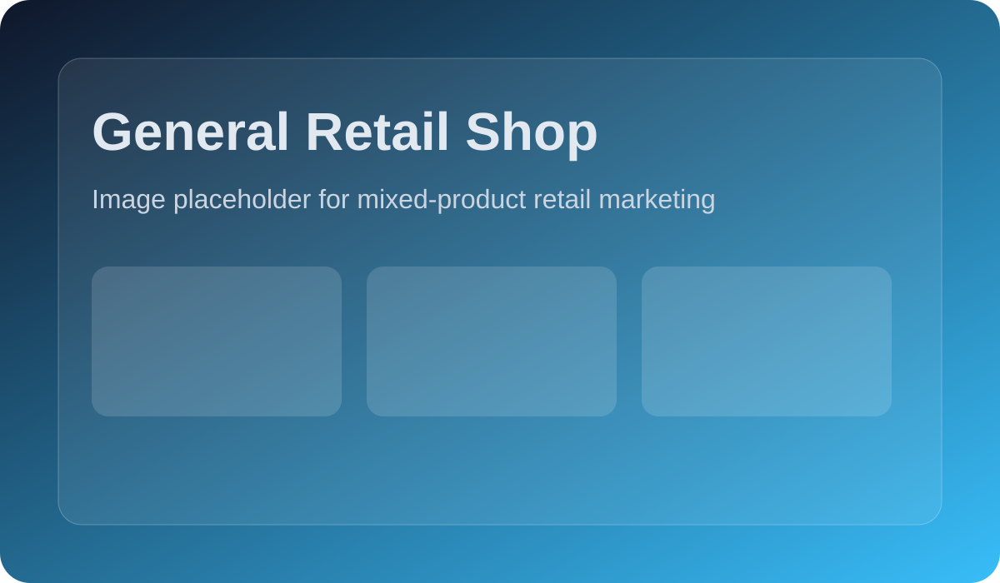
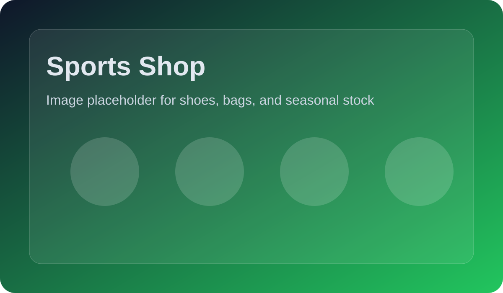
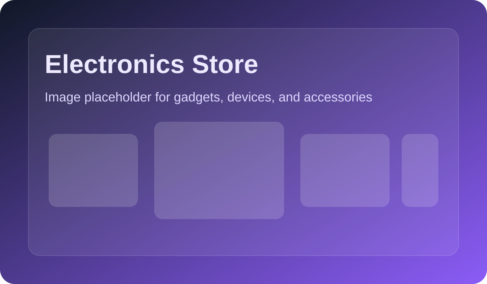

# Marketing Plan for Unified POS

## 1. Goal
Position Unified POS as an affordable, industry-ready POS system for single shops and multi-shop businesses.

## 2. Core Message
- Separate shop profiles for different business types
- Low-cost monthly plans for small retailers
- Easy setup with category presets, stock tracking, and sales reporting
- Works for retail, fashion, grocery, electronics, sports, medical, and mechanical shops

## 3. Target Customers
### Primary
- Small shop owners
- Retail stores with one branch
- Businesses that need a simple POS without high subscription costs

### Secondary
- Multi-shop owners
- Shop managers who want separate dashboards by shop type
- Businesses upgrading from manual billing

## 4. Product Positioning
Unified POS should be marketed as:
- Industry-level
- Shop-specific
- Budget-friendly
- Easy to deploy
- Built for growth

## 5. Shop Segments and Hooks
### General Retail
- Message: "One POS for mixed product stores"
- Best angle: simple billing and product control

### Sports Shop
- Message: "Handle sizes, variants, and fast-moving stock"
- Best angle: footwear, bags, and seasonal inventory

### Fashion and Boutique
- Message: "Clean collections for clothing and accessories"
- Best angle: product presentation and variants

### Electronics Store
- Message: "Track gadgets and accessories with confidence"
- Best angle: faster billing and serial-friendly workflows

### Grocery / Mini Mart
- Message: "Fast checkout for high-volume daily sales"
- Best angle: low-stock alerts and quick search

### Medical Shop
- Message: "Careful inventory for health products"
- Best angle: stock accuracy and reliable reporting

### Mechanical / Auto Parts
- Message: "Organize parts, services, and repairs in one system"
- Best angle: category control and service billing

## 6. Low-Cost Pricing Strategy
### Starter Plan
- For one shop
- Simple billing and inventory
- Best for price-sensitive customers

### Growth Plan
- For up to 3 shops
- Best value for growing businesses
- Includes industry templates and variant support

### Multi-Shop Plan
- For separate branches
- Best for customers who want centralized control

## 7. Channels
- Facebook pages and local groups
- Instagram reels and carousel posts
- WhatsApp product demo sharing
- Direct outreach to shop owners
- Local reseller and referral partnerships
- Short demo videos on YouTube or TikTok

## 8. Campaign Ideas
### Campaign 1: Start Small, Grow Smart
- Focus on low-cost plans
- Target single-shop owners
- Show how they can upgrade later

### Campaign 2: Separate Every Shop
- Focus on multi-shop organization
- Show how each shop gets its own settings and categories

### Campaign 3: Built for Your Industry
- Create one ad set per shop type
- Use industry-specific screenshots and messages

## 9. Content Plan
### Week 1
- Launch announcement post
- One short demo video
- One flyer for starter plan

### Week 2
- One post for sports shops
- One post for grocery shops
- One customer testimonial template

### Week 3
- One post for fashion and boutique shops
- One post for electronics stores
- One comparison post: manual billing vs POS

### Week 4
- One post for medical and mechanical shops
- One pricing post
- One lead-gen form or WhatsApp CTA post

## 10. Image Placeholders
Use these placeholders when designing ads, social posts, and brochures.

### Hero Banner

### Dashboard Screenshot

### POS Checkout Screen

### Shop Type Cards

### Pricing Plan Poster

### Social Media Ad

## 11. Suggested Creative Direction
- Use clean, bright visuals
- Highlight price first, then features
- Show one shop type per ad
- Keep text short and readable on mobile
- Use real app screenshots when available

## 12. Example CTA Copy
- Start your shop for less
- Separate each branch with one system
- Choose the plan that fits your store
- Sell faster with industry-ready billing

## 13. Success Metrics
- Number of demo requests
- Number of WhatsApp inquiries
- Trial to paid conversion rate
- Cost per lead
- Number of repeat referrals

## 14. Next Steps
- Replace placeholders with real product screenshots
- Prepare 3 social media creatives per shop type
- Build a one-page pricing flyer
- Record a 30-second demo video
- Launch a low-cost trial campaign
